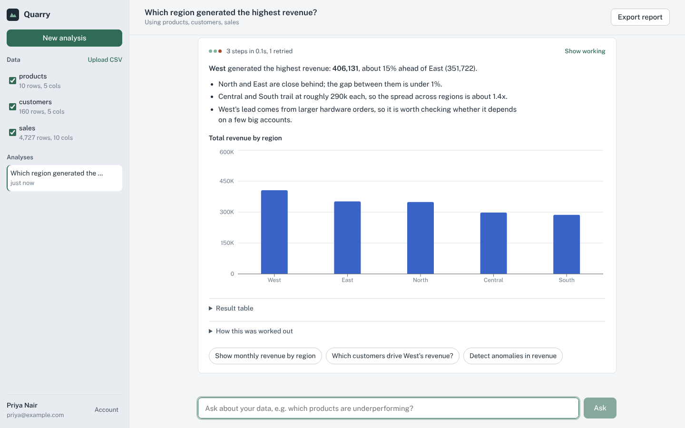
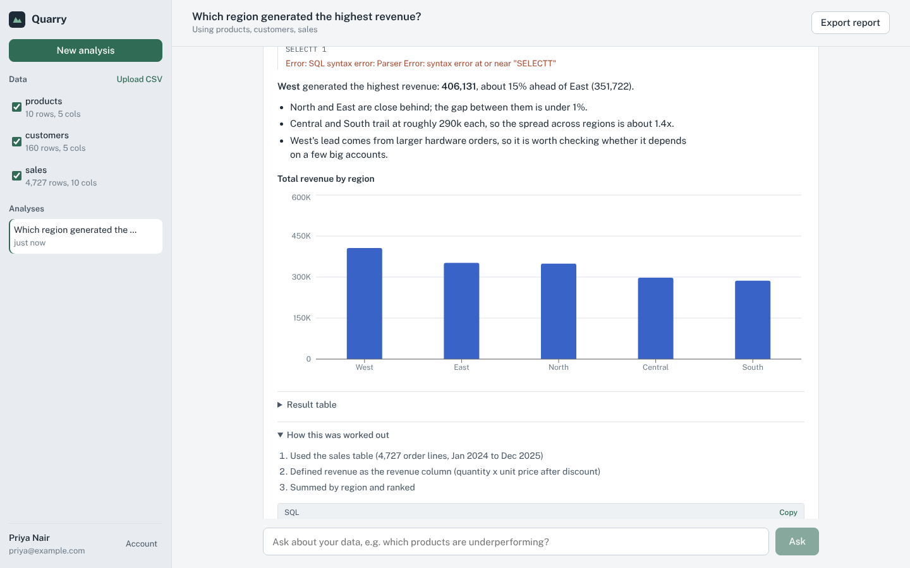
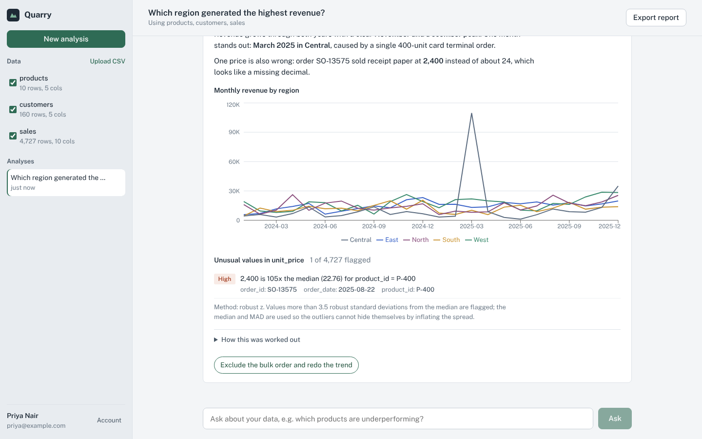
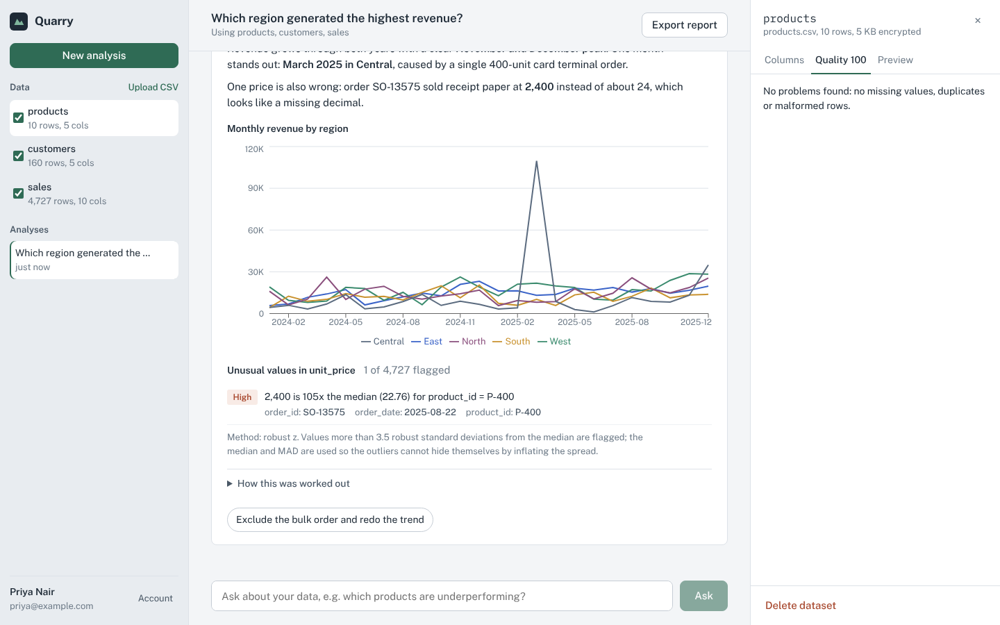
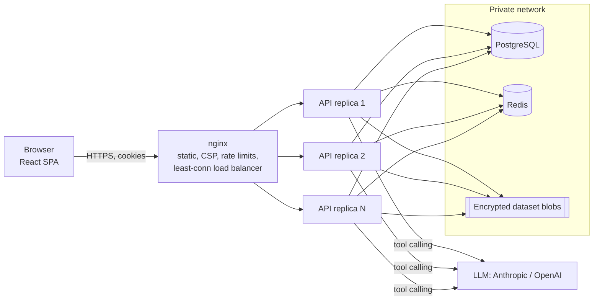

<div align="center">

# 🪨 Quarry

### An AI-powered data analyst for your CSV files

**Upload CSVs → ask questions in plain English → get answers, charts, SQL, anomalies and the reasoning behind them.**


</div>

---

## 📌 Overview

**Quarry** lets you upload one or more CSV files and ask questions about them in natural language.
For every question it returns:

- ✅ **The direct answer** with the key numbers
- 📊 **A chart** where it helps (bar, line, pie, scatter, area, forecast…)
- 🧾 **The SQL it ran** plus an equivalent **pandas** snippet
- 🔍 **Anomalies**, each with an explanation of *why* it was flagged
- 🧠 **How the answer was worked out**: every query, its timing, and any error it recovered from

It **remembers the conversation**, so follow-ups like *"now break that down by month"* work, and it
can **export the whole analysis as a report**.

> [!IMPORTANT]
> **The model never does arithmetic itself. Every number in an answer comes from a real query result.**

---

## 🎬 Demo & Screenshots

https://github.com/user-attachments/assets/f4d6d6b6-6c24-4ba2-9d18-8407ddd96c9b

> [!NOTE]
> 🎥 **30-second demo:** multi-file upload, plain-English questions with insights and reasoning, charts,
> follow-up context, forecasting, generated SQL, **anomaly detection with explanations**, data quality
> and multi-file joins. Also available as a file: [`docs/demo-30s.mp4`](docs/demo-30s.mp4).

| **Answer with chart** | **The working behind it** |
|:---:|:---:|
|  |  |
| **Anomalies, explained** | **Data quality on upload** |
|  |  |

---

## 📚 Table of Contents

1. [Assignment Requirements Checklist](#-assignment-requirements-checklist)
2. [Quick Start with Docker (recommended)](#-quick-start-with-docker-recommended)
3. [Local Development with npm](#-local-development-with-npm)
4. [Architecture](#-architecture)
5. [How a Question Is Answered](#-how-a-question-is-answered)
6. [Security](#-security)
7. [Testing](#-testing)
8. [Scaling and Load](#-scaling-and-load)
9. [Configuration](#-configuration)
10. [API Reference](#-api-reference)
11. [Sample Data](#-sample-data)
12. [Assumptions and Implementation Notes](#-assumptions-and-implementation-notes)
13. [Project Structure](#-project-structure)

---

## ✅ Assignment Requirements Checklist

### Core Features

| # | Requirement | Status | How it is met |
|:-:|---|:-:|---|
| 1 | **Upload and validate one or more CSV files** | ✅ | Multi-file upload (drag and drop or picker). Detects **encoding** (UTF-8, BOM, Windows-1252) and **delimiter** (`,` `;` tab `\|`), infers **types** (numbers incl. `$1,200.50`, dates, booleans; IDs with leading zeros stay text), sanitises column names, skips and reports malformed rows, enforces size/row/column limits. |
| 2 | **Answer questions in natural language** | ✅ | Tool-calling agent over the user's tables; answers **stream in live**. |
| 3 | **Generate business insights and summaries** | ✅ | Every answer leads with the direct answer and key numbers, then what stands out and a suggested action. |
| 4 | **Create charts** (Bar, Line, Pie, Scatter…) | ✅ | Bar, horizontal bar, stacked bar, line, area, pie, scatter, and forecast charts with an uncertainty band. |
| 5 | **Generate SQL and/or Pandas code** | ✅ | The SQL behind every answer is shown and copyable; pandas equivalents are generated when useful or asked for. |
| 6 | **Detect anomalies and explain why** | ✅ | Robust z-score (median and MAD) with optional per-group comparison, IQR fallback and a sign rule. Each flag says why, e.g. *"2,400 is 105x the median (22.76) for product_id = P-400"*. |
| 7 | **Explain the reasoning** | ✅ | **"How this was worked out"** lists the method; **"Show working"** lists every query the agent ran, its timing, and any error it recovered from. |
| 8 | **Maintain conversation context** | ✅ | Prior turns (and the SQL behind them) are sent with each question, so *"now by month"* or *"generate SQL for this analysis"* work. Conversations are saved. |

### Example Questions (all supported)

- 💰 *Which region generated the highest revenue?*
- 📈 *Show monthly sales trends.*
- 📉 *Which products are underperforming?*
- 🏆 *What are the top five customers?*
- 🧾 *Generate SQL for this analysis.*
- 🚨 *Detect anomalies in the dataset.*

### Bonus Features

| Bonus feature | Status | Bonus feature | Status |
|---|:-:|---|:-:|
| **Multi-file analysis** (joins across tables) | ✅ | **Authentication** (Argon2id, JWT cookies) | ✅ |
| **Data quality checks** | ✅ | **Export reports** (Markdown + CSV) | ✅ |
| **Forecasting** | ✅ | **Streaming responses** (SSE) | ✅ |
| **Agentic workflow** | ✅ | **Observability / logging** (JSON logs, Prometheus) | ✅ |
| **Tool calling** | ✅ | **Evaluation framework** | ✅ |
| **Caching** (query results + first answers) | ✅ | Dashboard generation | ➖ Not implemented |
| Semantic search | ➖ Not implemented | | |

### Technical Expectations & Deliverables

| Item | Status | Where |
|---|:-:|---|
| **Clean, modular code** | ✅ | `backend/app/{api,services,security}`, `frontend/src/{pages,components,api}` |
| **Proper error handling** | ✅ | Failed SQL is fed back to the agent to self-correct; rate limits, timeouts, `503` + `Retry-After` |
| **Documentation** | ✅ | This README + [`docs/`](docs/) |
| **Testing** | ✅ | Unit, integration, security, load and LLM-eval suites |
| **Complete source code** | ✅ | `backend/`, `frontend/` |
| **README with setup instructions** | ✅ | [Quick Start](#-quick-start-with-docker-recommended) |
| **Architecture diagram** | ✅ | [Architecture](#-architecture) + [`docs/architecture.md`](docs/architecture.md) |
| **Screenshots** | ✅ | [`docs/screenshots/`](docs/screenshots/) |
| **Demo video (10–30 s) or live link** | ✅ | Embedded at the top of this README + [`docs/demo-30s.mp4`](docs/demo-30s.mp4) |
| **Docker support** | ✅ | `docker-compose.yml`, `backend/Dockerfile`, `frontend/Dockerfile` |
| **Sample dataset(s)** | ✅ | [`sample_data/`](sample_data/) |
| **Assumptions / implementation notes** | ✅ | [Assumptions](#-assumptions-and-implementation-notes) |

---

## 🐳 Quick Start with Docker (recommended)

### Prerequisites

- **Docker Desktop** (or Docker Engine) with **Compose v2**
- An **Anthropic** or **OpenAI** API key *(optional: see offline demo mode below)*

### Step 1: Get the code and create your `.env` file

**macOS / Linux**

```bash
git clone https://github.com/sharvari382/Quarry.git
cd Quarry
cp .env.example .env
```

**Windows (PowerShell)**

```powershell
git clone https://github.com/sharvari382/Quarry.git
cd Quarry
Copy-Item .env.example .env
```

### Step 2: Generate secrets

Paste the four printed values into `.env`.

**With `make` and Python installed**

```bash
make secrets
```

**Without `make` (any OS, only needs Docker)**

```bash
docker run --rm python:3.13-slim python -c "import secrets,base64,os;print('POSTGRES_PASSWORD='+secrets.token_urlsafe(24));print('REDIS_PASSWORD='+secrets.token_urlsafe(24));print('JWT_SECRET='+secrets.token_urlsafe(64));print('DATA_ENCRYPTION_KEYS='+base64.urlsafe_b64encode(os.urandom(32)).decode())"
```

### Step 3: Add your LLM key

In `.env`, set **one** of the following:

```ini
# Anthropic (default)
LLM_PROVIDER=anthropic
ANTHROPIC_API_KEY=sk-ant-...

# or OpenAI / any OpenAI-compatible endpoint
LLM_PROVIDER=openai
OPENAI_API_KEY=sk-...
LLM_MODEL=gpt-4.1-mini
```

> [!TIP]
> **No API key yet?** Set `LLM_PROVIDER=fake` and `APP_ENV=development` to click through the app.
> It will profile your data instead of answering questions.

### Step 4: Build and start

```bash
docker compose up -d --build
```

### Step 5: Open the app

👉 **http://localhost:8080**. Create an account and click **Try the sample sales data**.

This starts **nginx**, **3 API replicas**, **PostgreSQL** and **Redis**.

### Useful Docker commands

| Command | What it does |
|---|---|
| `docker compose ps` | Health of every service |
| `docker compose logs -f api` | Follow the structured JSON logs |
| `docker compose up -d --scale api=5` | Run more API replicas (no config change needed) |
| `docker compose --profile monitoring up -d` | Add Prometheus on **:9090** |
| `docker compose down` | Stop the stack (**data volumes are kept**) |
| `docker compose down -v` | Stop and **delete all data** |

> [!WARNING]
> **Deploying on a server (not localhost)?** Cookies are `Secure`, so the app must be served over
> **HTTPS** on any hostname other than `localhost`. Put a TLS-terminating proxy or load balancer
> (e.g. Caddy, Traefik, a cloud load balancer) in front of port `8080`.

---

## 💻 Local Development with npm

Runs the API with **SQLite** and in-memory rate limits; **no Docker, Postgres or Redis needed**.
You need **two terminals**.

### Prerequisites

- **Python 3.12+**
- **Node.js 22+** and **npm**

### Terminal 1: Backend API (port 8000)

**Windows (PowerShell)**

```powershell
cd Quarry\backend
python -m venv .venv
.\.venv\Scripts\Activate.ps1
pip install -r requirements-dev.txt

# Optional: use a real LLM (otherwise runs in offline "fake" mode)
$env:LLM_PROVIDER="anthropic"
$env:ANTHROPIC_API_KEY="sk-ant-..."

uvicorn app.main:app --reload --port 8000
```

**macOS / Linux**

```bash
cd Quarry/backend
python3 -m venv .venv
source .venv/bin/activate
pip install -r requirements-dev.txt

# Optional: use a real LLM (otherwise runs in offline "fake" mode)
export LLM_PROVIDER=anthropic ANTHROPIC_API_KEY=sk-ant-...

uvicorn app.main:app --reload --port 8000
```

### Terminal 2: Frontend (port 5173)

```bash
cd Quarry/frontend
npm install
npm run dev
```

👉 Open **http://localhost:5173**. The dev server proxies `/api` to `:8000`.
API docs: **http://localhost:8000/api/docs**

### npm scripts

| Command | What it does |
|---|---|
| `npm install` | Install frontend dependencies |
| `npm run dev` | Start the Vite dev server with hot reload |
| `npm run build` | Type-check and build the production bundle into `dist/` |
| `npm run preview` | Serve the production build locally |
| `npm test` | Run the component tests (Vitest) |
| `npm run typecheck` | TypeScript check only |

---

## 🏗️ Architecture



| Layer | Technology |
|---|---|
| **Frontend** | React 19 + TypeScript + Vite, Recharts, react-markdown. No UI kit; hand-written CSS. |
| **Backend** | FastAPI, SQLAlchemy 2 + Alembic, **DuckDB** for SQL over the data, pandas/NumPy for statistics. |
| **Infra** | nginx (load balancer + edge), gunicorn with uvicorn workers, PostgreSQL 17, Redis 7, Docker Compose. |

The API is **stateless**, so any replica can serve any request. Full write-up with the request
sequence diagram and design decisions: **[docs/architecture.md](docs/architecture.md)**.

---

## 🧠 How a Question Is Answered

1. **Context:** the question, the schema of the selected tables (column names, types, ranges,
   examples) and the last 12 turns go to the LLM along with **six tools**:
   `run_sql`, `create_chart`, `detect_anomalies`, `profile_table`, `forecast`, `final_answer`.
2. **Tool calls:** the model calls tools; each call is **validated and executed in a sandbox**, and
   the real result goes back to the model. Progress streams to the browser as it happens.
3. **Self-correction:** if a query fails, the error is returned to the model, which fixes it and retries.
4. **Final answer:** the model finishes with `final_answer`: answer, reasoning steps, main SQL,
   pandas code, and suggested follow-ups.

---

## 🔒 Security

Details, plus the test that proves each control: **[docs/security.md](docs/security.md)**

- **Passwords:** Argon2id, password policy, account lockout, per-IP and per-account rate limits.
- **Sessions:** `HttpOnly` + `Secure` + `SameSite=Strict` cookies; 15-minute access JWT; rotating
  refresh tokens with reuse detection; logout and *"sign out everywhere"* revoke server side; CSRF double-submit.
- **Tenant isolation:** every query filters by owner; foreign ids return `404`.
- **Encryption at rest:** uploaded data is encrypted (Fernet, with key rotation).
- **SQL sandbox:** model-written SQL runs through **3 layers** (parser guard, locked-down DuckDB with
  no file or network access, only the caller's tables), with a timeout and memory cap.
  **Model-written Python is never executed.**
- **Prompt injection:** data cannot change anything, because **every tool is read-only**.
- **Hardening:** CSP, security headers, non-root read-only containers, private network for Postgres and Redis.

---

## 🧪 Testing

| Command | What it runs |
|---|---|
| `make test` | **120 backend tests** (92% coverage) + **5 frontend tests** |
| `make lint` | Static checks (ruff) |
| `make load-test` | Locust load test *(needs a running stack)* |
| `make eval` | LLM answer-accuracy evaluation *(needs an API key)* |

**Without `make`:**

```bash
# Backend (inside the activated venv)
cd backend && python -m pytest --cov=app

# Frontend
cd frontend && npm run typecheck && npm test
```

Integration tests drive full agent turns with a **scripted model against real data**, so they are
deterministic and free. See **[docs/testing.md](docs/testing.md)** for what each suite covers and the
load test history.

---

## 📈 Scaling and Load

Measured on a 2-vCPU sandbox with **one** API instance (4 workers), **200 concurrent users**:

| Throughput | p50 latency | p95 latency | Errors |
|:-:|:-:|:-:|:-:|
| **~96 req/s** | **19 ms** | **340 ms** | **0.37 %** *(all deliberate `503`s with `Retry-After`)* |

Load testing found **four real problems, all fixed**: SQLite write locks (use Postgres), CSRF rotation
breaking other tabs, DB connections held during CPU work, and heavy uploads starving cheap reads
(fixed with bulkheads and fast load shedding). Production compose runs **3 replicas** behind nginx's
least-connections balancer; add replicas with `--scale`.
More in [docs/testing.md](docs/testing.md#scaling-the-deployment).

---

## ⚙️ Configuration

All settings are **environment variables** (see `.env.example` and `backend/app/config.py`).

| Variable | Default | Purpose |
|---|---|---|
| `LLM_PROVIDER` | `fake` | `anthropic`, `openai` (any OpenAI-compatible endpoint), or `fake` |
| `LLM_MODEL` | `claude-sonnet-5-5` | Model id for the chosen provider |
| `ANTHROPIC_API_KEY` / `OPENAI_API_KEY` | | Provider credentials |
| `JWT_SECRET` | dev value | Signing key; **the app refuses to start in production with the dev value** |
| `DATA_ENCRYPTION_KEYS` | dev value | Comma-separated Fernet keys; first encrypts, all decrypt |
| `DATABASE_URL` | SQLite file | Postgres in Docker |
| `REDIS_URL` | unset (in-memory) | **Required with more than one replica** |
| `MAX_UPLOAD_MB` / `MAX_ROWS_PER_FILE` / `MAX_COLUMNS` | 25 / 1,000,000 / 300 | Upload limits |
| `CHAT_RATE_LIMIT_PER_MINUTE` / `DAILY_LLM_CALLS_PER_USER` | 20 / 300 | Cost protection |
| `QUERY_TIMEOUT_SECONDS` / `QUERY_ROW_LIMIT` | 10 / 5,000 | SQL sandbox limits |
| `LLM_MAX_TOOL_STEPS` / `HISTORY_MESSAGES` | 6 / 12 | Agent loop bounds |

> [!CAUTION]
> With `APP_ENV=production` the API **refuses to start** if `JWT_SECRET` or `DATA_ENCRYPTION_KEYS`
> still hold dev values, if `COOKIE_SECURE=false`, or if `LLM_PROVIDER=fake`.

---

## 🔌 API Reference

Interactive docs at **`/api/docs`** when `APP_ENV` is not `production`.

| Method | Path | Purpose |
|---|---|---|
| `POST` | `/api/auth/register`, `/api/auth/login` | Create account / sign in (sets cookies) |
| `POST` | `/api/auth/refresh`, `/api/auth/logout`, `/api/auth/logout-all` | Session management |
| `GET` | `/api/auth/me` | Current user |
| `POST` | `/api/datasets` | Upload 1 to 5 CSV files (multipart) |
| `GET` | `/api/datasets`, `/api/datasets/{id}`, `/api/datasets/{id}/preview` | List, schema + quality, first rows |
| `DELETE` | `/api/datasets/{id}` | Delete dataset and its encrypted file |
| `POST` | `/api/datasets/query`, `/api/datasets/query.csv` | Run read-only SQL; download as CSV |
| `GET` / `POST` | `/api/conversations` | List / create analyses |
| `GET` / `PATCH` / `DELETE` | `/api/conversations/{id}` | Read with messages / rename or change datasets / delete |
| `POST` | `/api/conversations/{id}/ask` | Ask a question; responds with a **Server-Sent Events** stream |
| `GET` | `/api/conversations/{id}/export.md` | Markdown report |
| `GET` | `/healthz`, `/readyz`, `/metrics` | Liveness, readiness, Prometheus (internal only) |

---

## 🗂️ Sample Data

`sample_data/` holds a small **fictional point-of-sale business** (generated by
`scripts/generate_sample_data.py`, seed 42):

| File | Contents |
|---|---|
| **`sales.csv`** | 4,727 order lines, Jan 2024 to Dec 2025, 5 regions, 3 channels, seasonality and growth |
| **`customers.csv`** | 160 customers with segment and region |
| **`products.csv`** | 10 products with category, list price and unit cost |

**Planted problems for the anomaly detector to find:**

- 📦 A **400-unit bulk order** (March 2025, Central)
- ↩️ A **return booked as a negative sale**
- 💲 A **price typed as 2,400 instead of 24**
- 📉 The **Central region nearly disappearing** in June 2025

**Questions to try:** *Which region generated the highest revenue? · Show monthly sales trends ·
Which products are underperforming? · What are the top five customers? · Generate SQL for this
analysis · Detect anomalies in the dataset · Forecast revenue for the next six months ·
Compare gross margin by category* (joins `products`).

---

## 📝 Assumptions and Implementation Notes

- **Execution model:** the LLM writes SQL (DuckDB dialect); it **does not execute Python**. Pandas
  code is generated for the reader to reuse. This trades a little flexibility for a large reduction
  in risk, and SQL covers aggregation, joins, windows and dates well.
- **Dataset scale:** up to 25 MB / 1M rows per file is held in memory per query. Larger data would
  move to object storage with DuckDB reading Parquet directly, and ingestion to a job queue.
- **"Revenue" and similar terms** are interpreted from the schema; when ambiguous, the model picks a
  definition and **states it in the answer**.
- **Anomaly threshold:** 3.5 robust standard deviations (Iglewicz and Hoaglin), adjustable by the agent.
- **Forecasting** is deliberately simple (linear trend, plus monthly seasonality with 24+ months,
  one-off spikes smoothed first). It is explainable and **labelled as a projection, not a promise**.
- **Caching:** query results are cached for 10 minutes by dataset content hash + SQL. Whole answers
  are cached only for the first question in a conversation, keyed by data, question, model and prompt version.
- **Not included:** email verification and password reset (needs an email provider), MFA, SSO, and
  built-in HTTPS/TLS termination. These are the next additions for a real deployment.
- **Screenshots** in `docs/screenshots/` were captured from this build.

---

## 📁 Project Structure

```
quarry/
├── backend/                  FastAPI service (see docs/architecture.md for the module map)
│   ├── app/                  application code (api, services, security)
│   ├── alembic/              database migrations
│   ├── tests/                unit, integration, security, load, evals
│   ├── Dockerfile            multi-stage, non-root
│   └── gunicorn.conf.py
├── frontend/                 React + TypeScript SPA
│   ├── src/                  pages, components, API client
│   └── Dockerfile            builds the SPA into the nginx image
├── nginx/                    edge proxy and load balancer config
├── ops/prometheus.yml        metrics scraping (optional profile)
├── sample_data/              demo CSVs
├── scripts/                  sample data generator
├── docs/                     architecture, security, testing, screenshots
├── docker-compose.yml
├── Makefile
└── .github/workflows/ci.yml  lint, tests, audit, image build, stack smoke test
```
