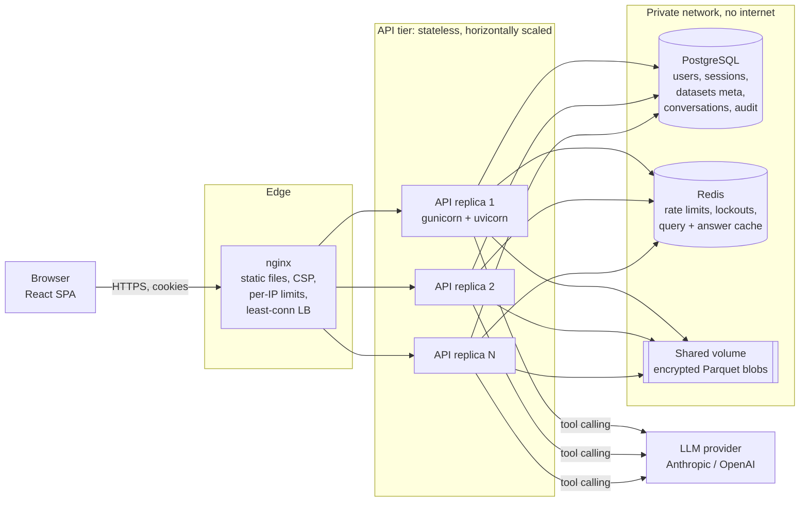
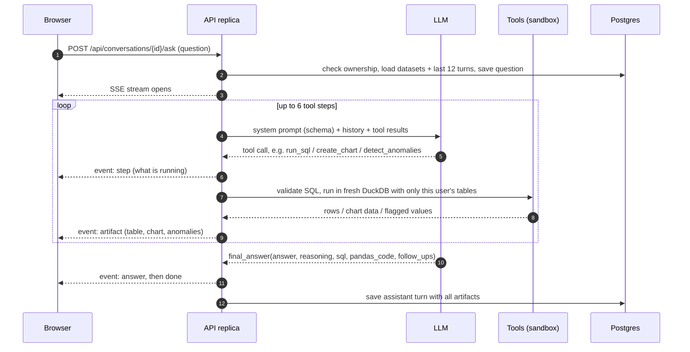

# Architecture

## System overview



Every API replica is identical and keeps no state of its own: sessions are signed cookies plus
rows in Postgres, counters and caches are in Redis, and dataset files are on a shared volume.
That is what lets nginx send any request to any replica and lets you add replicas with
`docker compose up --scale api=N`.

## One question, end to end



## Why the pieces are shaped this way

| Decision | Reason |
|---|---|
| **The LLM never computes numbers.** It writes SQL and picks tools; DuckDB and the statistics module produce every figure. | Models are unreliable at arithmetic over thousands of rows. Tool results are exact, repeatable and testable. |
| **Generated SQL, not generated Python, is executed.** Pandas code is generated for the user to read, never run. | Executing model-written Python is remote code execution. A read-only SQL dialect can be sandboxed. |
| **Three-layer SQL sandbox**: parser-based guard (single SELECT, no file/network functions) → fresh in-memory DuckDB per query with external access disabled and config locked → connection contains only the caller's tables. | Any one layer could have a gap; all three would have to fail together for a leak. |
| **Structured `final_answer` tool** instead of free text. | The UI gets answer, reasoning, SQL, pandas and follow-ups as separate fields, and the model has a clear "done" signal. |
| **Deterministic anomaly detection** (median/MAD robust z-score, optional per-group, IQR fallback, sign rule). | Explainable ("2,400 is 105x the median for P-400"), not fooled by the outliers it is hunting (mean/std masking), and unit tested. |
| **CSV normalised to Parquet, then encrypted** (Fernet: AES-128-CBC + HMAC-SHA256, key rotation via MultiFernet). | Typed columns once instead of re-parsing on every query; encrypted at rest; tampering is detected. |
| **Server-Sent Events** for the ask endpoint. | One-way progress stream over plain HTTP; works through nginx with buffering off; simpler than WebSockets. |
| **Answer cache only for first questions** (key = dataset hashes + normalised question + model + prompt version). | Follow-ups depend on conversation context, so caching them would return wrong answers. |
| **Bulkheads** (bounded slots for CSV parsing, password hashing, queries) + **503 load shedding**. | Found by load testing: CPU-heavy requests starved cheap ones. Now heavy work queues briefly, then fails fast with `Retry-After`. |
| **Provider-neutral LLM interface** with Anthropic, OpenAI-compatible and a scripted fake. | Swap vendors via env; full test suite runs offline and deterministically. |

## Code map

```
backend/app/
  main.py               app factory, error handlers (incl. 503 shedding)
  config.py             all settings from env; refuses unsafe production config
  middleware.py         request id, access log, metrics, security headers (pure ASGI, SSE-safe)
  deps.py               current user, CSRF check, per-user rate limit
  security/             passwords (Argon2id), tokens (JWT + refresh), crypto (Fernet), rate_limit
  api/                  auth, datasets, conversations (SSE), health
  services/
    csv_ingest.py       validation, encoding/delimiter detection, typing, data quality
    storage.py          encrypted blob store + bounded LRU of decrypted tables
    sql_guard.py        SQL validation (layer 1)
    query_engine.py     DuckDB sandbox (layers 2 and 3), timeout, result cache
    analytics.py        anomalies, profiling, forecasting
    tools.py            tool schemas for the LLM + executors
    agent.py            tool-calling loop, streaming events, answer cache
    prompts.py          versioned system prompt
    llm/                provider adapters (anthropic, openai, fake)
    bulkhead.py         concurrency limits for CPU-heavy work
    kv.py               Redis / in-memory key-value
```
